<p align="center">
  <picture>
    <source media="(prefers-color-scheme: dark)" srcset="docs/readme/hero-dark.png">
    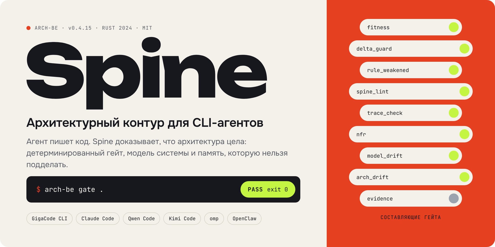
  </picture>
</p>

<p align="center">
  <a href="https://github.com/romannekrasovaillm/spine-bank/actions/workflows/ci.yml"></a>
  
  
  
  
</p>

<p align="center">
  <b><a href="#why">Зачем</a></b> ·
  <b><a href="#values">Восемь причин</a></b> ·
  <b><a href="#flow">Как работает</a></b> ·
  <b><a href="#editions">Редакции</a></b> ·
  <b><a href="#шаг-0-бинарь-30-секунд">Быстрый старт</a></b> ·
  <b><a href="CHANGELOG.md">Что нового</a></b> ·
  <b><a href="README.en.md">English</a></b>
</p>

---

<a name="why"></a>

<picture>
  <source media="(prefers-color-scheme: dark)" srcset="docs/readme/positioning-dark.png">
  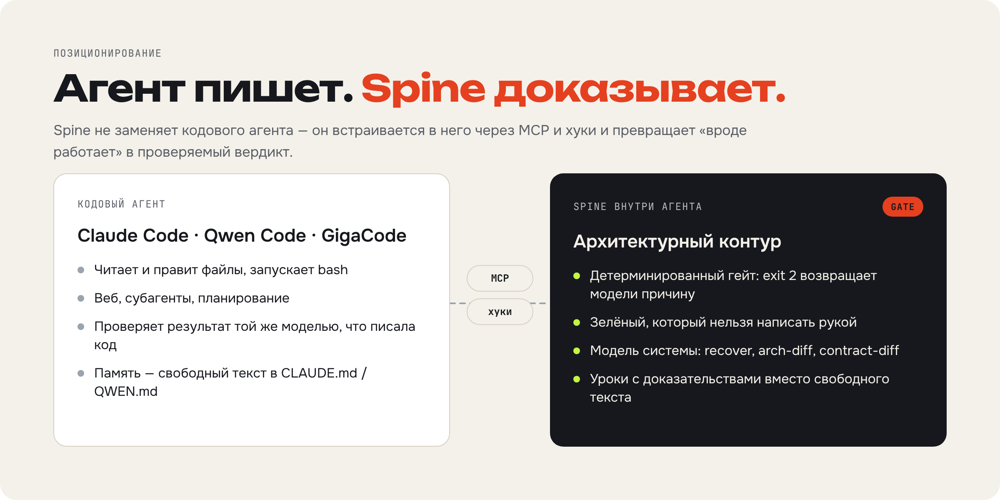
</picture>

Claude Code, Qwen Code и GigaCode отвечают на вопрос «как быстро написать код».
Spine отвечает на другой: **как доказать, что код агента не нарушил архитектуру
и стандарты, — и не дать агенту подделать это доказательство.**

Spine — детерминированный контур архитектурного контроля. Он подключается к
кодовому агенту как MCP-сервер и набор хуков и проверяет то, что агент
сгенерировал. Основная поставка — сборка `core` без собственной LLM: думает
ваш агент, Spine держит позвоночник — модель системы, правила, гейт и память
с доказательствами.

<a name="values"></a>

<picture>
  <source media="(prefers-color-scheme: dark)" srcset="docs/readme/values-dark.png">
  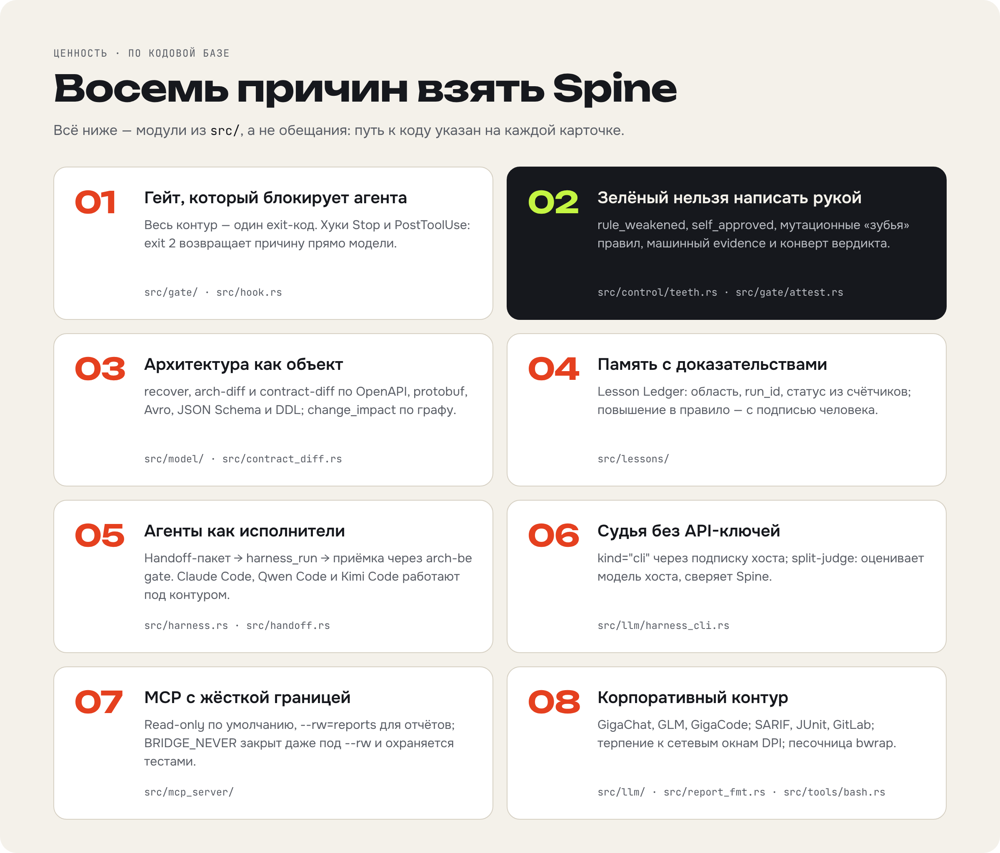
</picture>

<details>
<summary><b>Разбор по кодовой базе — ценность по сравнению с Qwen Code и Claude Code</b></summary>

<br>

**1. Детерминированный гейт, который может заблокировать агента.**
`arch-be gate` прогоняет весь контур: fitness-правила из `CONSTRAINTS.yaml`,
guard дельт, линтер, трассировку, NFR, дрейф модели и кода — и сводит
результат в один exit-код (`src/gate/mod.rs`). Маршрут проверки (fast,
standard или critical) вычисляется из git-диффа; если дифф получить нельзя,
выбирается critical. `arch-be connect` прописывает в `.claude/settings.json`
хуки `Stop` и, опционально, `PostToolUse`: exit 2 блокирует модель, и причина
уходит обратно агенту (`src/connect/hooks.rs`, `src/hook.rs`). У Claude Code и
Qwen Code есть механизм хуков — Spine поставляет предметную проверку.

**2. Зелёный нельзя написать рукой.**
- `rule_weakened` ловит ослабление правил относительно базы, `self_approved` —
  override или ADR, созданные агентом в своём же диапазоне коммитов
  (`src/control/registry.rs`).
- `rules teeth` проверяет каждое правило мутацией на копии репозитория;
  тривиальное правило вроде `command: 'true'` помечается как правило без зубьев
  (`src/control/teeth.rs`).
- Отчёт о прогоне пишет программа (`evidence record`) с exit-кодом, HEAD и
  хешем входов; конверт вердикта сверяется с деревом через `--verify-envelope`
  (`src/gate/attest.rs`).
- `redteam` засевает в код нарушения стандарта и строит карту того, какой слой
  их обнаружил (`src/redteam/`).

Проверка вынесена в механику, которую модель не может обойти.

**3. Архитектура как объект.** `recover` восстанавливает граф компонентов и
связей по коду со ссылками на `файл:строка`; `arch-diff` показывает, что PR
изменил в архитектуре; `contract-diff` находит ломающие изменения в OpenAPI,
protobuf, Avro, JSON Schema и DDL; `change_impact` считает радиус изменения по
графу модели. Плюс ADR-реестр, NFR и OpenSpec.

**4. Память с доказательствами.** Реестр уроков (`src/lessons/`) живёт в
`.arch/lessons/ledger.jsonl`. У урока есть область действия (файл, модуль,
репозиторий, пользователь, организация), статус выводится из счётчиков
доказательств с `run_id`, а не из текста LLM. Повышение урока до
fitness-правила на маршрутах standard и critical требует подписи человека. В
контекст агента уроки попадают через хуки `SessionStart` и `UserPromptSubmit`.

**5. Агенты как исполнители.** Spine собирает handoff-пакет (TASK,
ARCHITECTURE, CONSTRAINTS, RUBRIC, ROLLBACK, MANIFEST) и запускает Claude Code,
Qwen Code, Kimi Code и другие через `harness_run`, а приёмка идёт через
`accept_cmd = "arch-be gate ."` (`src/harness.rs`). Архитектор и Spine ставят
задачу и принимают результат, кодовый агент выполняет.

**6. LLM-судья без своих API-ключей.** `kind="cli"` запускает уже
авторизованный `claude -p` или аналог подпроцессом — платит подписка хоста
(`src/llm/harness_cli.rs`). Split-judge (`rubric_prompt` / `rubric_verify`):
оценивает модель хоста, Spine механически сверяет. Связка
«критерий ↔ fitness-правило» (ADR-093): красное необходимое правило проваливает
критерий без судьи, «чисто» судьи при красном правиле уходит человеку;
блокирующей связка становится только после теневого режима, зубьев, допуска
судьи и подписи (`src/gate/binding.rs`, `arch-be rubric bindings` / `promote`).

**7. MCP со строгой границей доступа.** По умолчанию — только чтение;
`--rw=reports` разрешает запись лишь отчётов. Список `BRIDGE_NEVER` (bash,
файлы, веб, субагенты) закрыт даже под `--rw` и защищён тестами
(`src/mcp_server/types.rs`).

**8. Корпоративный контур.** Провайдеры GigaChat и GLM, совместимость с
GigaCode, выгрузка в SARIF, JUnit и GitLab для CI, повтор вызовов модели при
сетевых окнах DPI, песочница bwrap для bash.

</details>

<a name="flow"></a>

<picture>
  <source media="(prefers-color-scheme: dark)" srcset="docs/readme/flow-dark.png">
  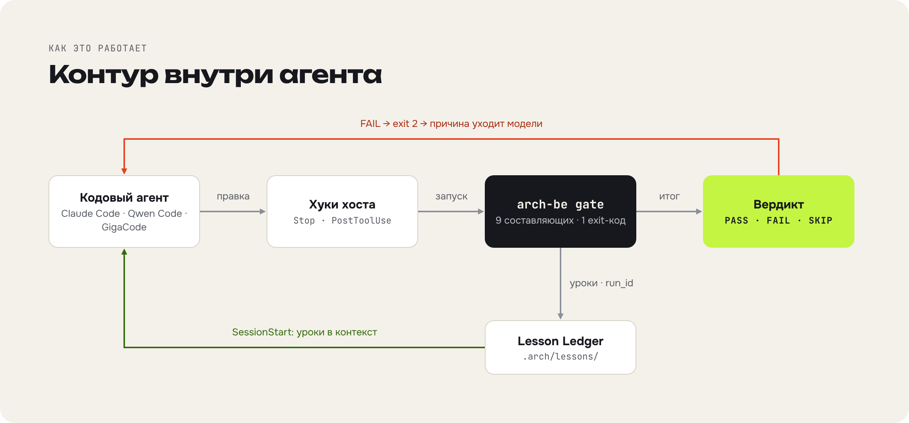
</picture>

Агент правит код → хук хоста запускает `arch-be gate` → гейт выдаёт вердикт.
`FAIL` возвращается модели через exit 2 вместе с причиной, доказательства
прогона пополняют Lesson Ledger, а проверенные уроки на старте следующей
сессии попадают в контекст агента.

<a name="editions"></a>

<picture>
  <source media="(prefers-color-scheme: dark)" srcset="docs/readme/editions-dark.png">
  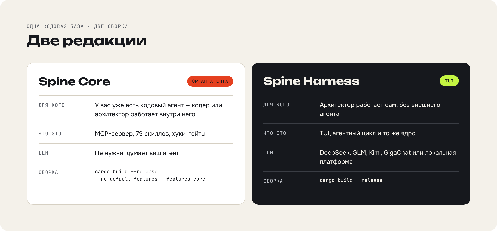
</picture>

| | **Spine Core** | **Spine Harness (TUI)** |
|---|---|---|
| Бинарь (релиз) | `arch-be-core-linux-x86_64` (~16 МБ) | `arch-be-linux-x86_64` (~24 МБ) |
| Сборка | `cargo build --release --no-default-features --features core` | `cargo build --release` |

Одна кодовая база — специально: ядро, тесты (1826 в редакции harness, 1473 в
core) и CI общие, версии не расходятся. Различие — только в том, кто
«думает»: ваш агент или Spine сам. Это форк **Spine Banking Edition**,
перевёрнутый по плану инверсии. Ядро — MIT; слой `banking/` в публикацию не
входит.

> Релизные заметки 0.3.4 — 0.4.0, раньше открывавшие этот README, переехали в
> [docs/RELEASE-NOTES.md](docs/RELEASE-NOTES.md); полная история — в
> [CHANGELOG.md](CHANGELOG.md).

---

# Режим 1. Spine Core внутри вашего харнесса

## Шаг 0. Бинарь (30 секунд)

Linux / macOS — одна команда на платформу (имя файла — из таблицы):

```bash
curl -L -o arch-be https://github.com/romannekrasovaillm/spine-bank/releases/latest/download/arch-be-core-linux-x86_64
chmod +x arch-be && mv arch-be ~/.local/bin/
```

| Платформа | Файл релиза |
|---|---|
| Linux x86_64 | `arch-be-core-linux-x86_64` |
| Linux aarch64 | `arch-be-core-linux-aarch64` |
| macOS arm64 (Apple Silicon) | `arch-be-core-macos-arm64` |
| Windows x86_64 | `arch-be-core-windows-x86_64.exe` |

Windows (PowerShell):

```powershell
curl.exe -L -o arch-be.exe https://github.com/romannekrasovaillm/spine-bank/releases/latest/download/arch-be-core-windows-x86_64.exe
# положите arch-be.exe в каталог из PATH
```

Сверка целостности: `SHA256SUMS` из того же релиза — `sha256sum --check SHA256SUMS` (Linux) / `shasum -a 256 --check SHA256SUMS` (macOS).

## Шаг 1. Архитектурный дифф за 5 минут

Первая ценность — до всякого подключения. В любом git-репозитории, из
ветки вашего PR:

```bash
arch-be arch-diff --base main
```

Один экран отвечает на вопрос «что этот PR изменил в архитектуре»: новые и
исчезнувшие связи между компонентами, новые внешние системы и хранилища,
изменения контрактов (ломающее или аддитивное), сдвиги NFR, задетые
инварианты и ADR, маршрут значимости — у каждого факта основание
`файл:строка`, без LLM. Пустой дифф («Архитектурных изменений нет»)
означает: архитектуре ревью не нужно. Модель (`model/`) не обязательна:
без неё граф строится по манифестам сборки — просто без колонки «в модели».

- Ребро, которого нет в модели, — не только находка, но и готовая правка:
  пронумерованное предложение принимается `arch-be arch-diff accept <n…>`
  (оформляется дельтой; предложение, противоречащее инварианту, помечено ⚠)
  или отклоняется `arch-be arch-diff reject <n> --reason "…"`. Модель
  перестаёт отставать: её поддержка — одно решение на изменение, а не
  отдельная работа.
- Форматы: `--format md` (сводка одного экрана, дефолт), `mermaid`
  («до/после», рёбра вне модели — пунктиром), `json` (машинный контракт
  `arch-be/arch-diff/v1`, детерминирован), `sarif` (находки прямо в
  интерфейсе PR).
- В CI дифф приезжает сам: `arch-be connect ci --provider gitlab|github|jenkins`
  рендерит джобу, которая публикует дифф **одним комментарием** MR/PR и
  обновляет его на каждом пуше.

Подробности — [docs/arch-diff.md](docs/arch-diff.md).

## Шаг 2. Подключение

### GigaCode CLI (форк Qwen Code)

Целевой сценарий для архитекторов. Механика — как у Qwen Code
(project-level `mcpServers`); проверено живыми прогонами на **двух версиях
qwen-code: 0.0.5 (старая) и 0.24.0 (свежая)**:

```bash
cd ~/projects/my-project
arch-be connect qwen        # пишет .qwen/settings.json (мердж, чужое цело)
```

```jsonc
// .qwen/settings.json — что записалось:
{"mcpServers": {"spine": {"command": "arch-be", "args": ["mcp", "serve"]}}}
```

> Пути `.qwen/settings.json` и `.qwen/skills/` — от Qwen Code; в GigaCode CLI
> адаптируйте их под фактический каталог вашей сборки (например
> `.gigacode/…`). Форматы ключей те же.

Перезапустите GigaCode в каталоге проекта. Если сервер в статусе
«Pending approval» (обязательно в qwen-code 0.24+): `qwen mcp approve spine`.
Проверка: `qwen mcp list` → `spine … ✓ Connected`.

**Развёртывание и работа силами самого агента GigaCode** — инструкция, адресованная агенту: дайте ему [docs/GIGACODE.md](docs/GIGACODE.md) (установка, подключение, гейт, рубрики и связки 0.4.17).

#### С нуля: сценарии архитектора (все кадры — реальные прогоны)

**0. Наполнение пустого проекта.** Банковской зоны в форке нет — спайн,
правила, модель и базу знаний агент создаёт под ваш проект сам:

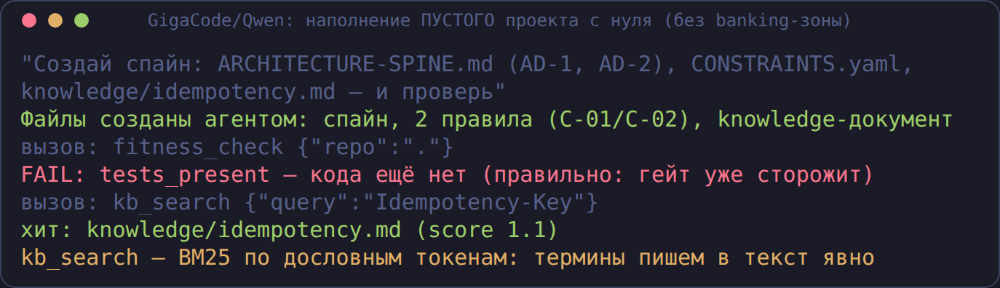

**1. Подключение и fitness-гейт.** Агент сам находит 2 нарушения
(`f64` для денег, нет тестов), переписывает код и перепроверяет до PASS:

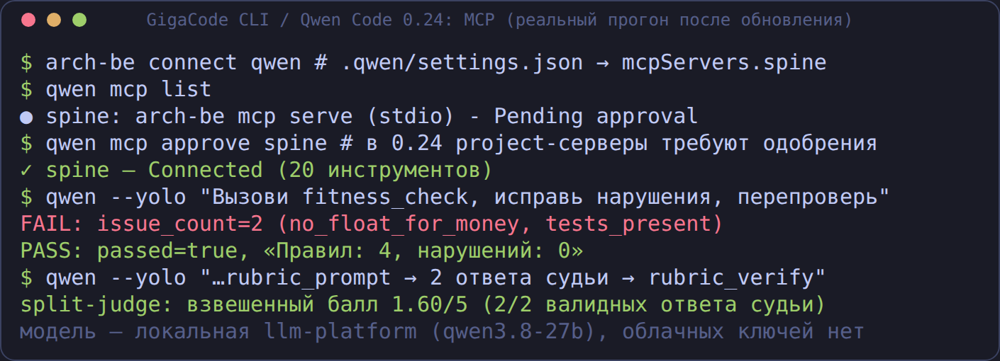

**2. Маршрут + модель + трассировка.** Перед изменением — скоринг
значимости, состав модели, полнота цепочки REQ→NFR→AD→CMP→правила:

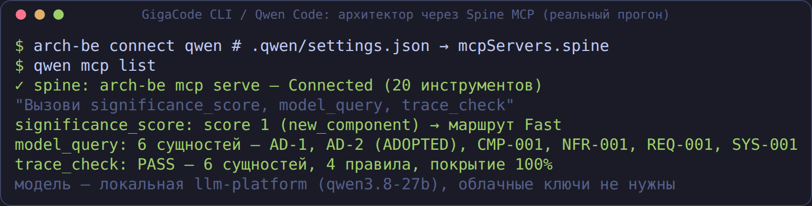

**3. Контракты.** Линт OpenAPI/AsyncAPI и diff версий с поимкой
ломающих изменений:

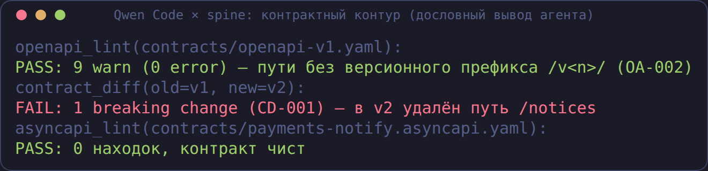

**4. Оценка ADR рубрикой — без API-ключей (split-judge).** Spine отдаёт
промпт и схему, судит сам GigaCode (2 независимых прогона), Spine собирает
медиану и проверяет цитаты:

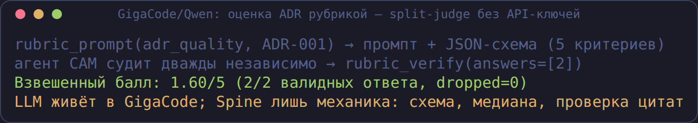

**5. Скиллы.** 62 архитектурных скилла через `skill_search`/`skill_load` —
агент применяет их к контексту вашего проекта (обзор библиотеки —
[docs/skills_for_architects.md](docs/skills_for_architects.md)):

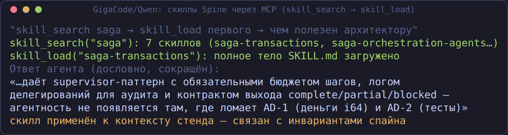

**6. База знаний.** Корпоративные заметки/стандарты проекта — через
`kb_search`:

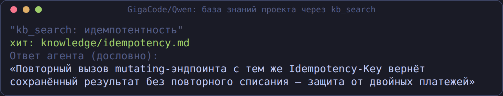

**7. Диаграммы.** Рендер mermaid/C4 прямо в сессии:

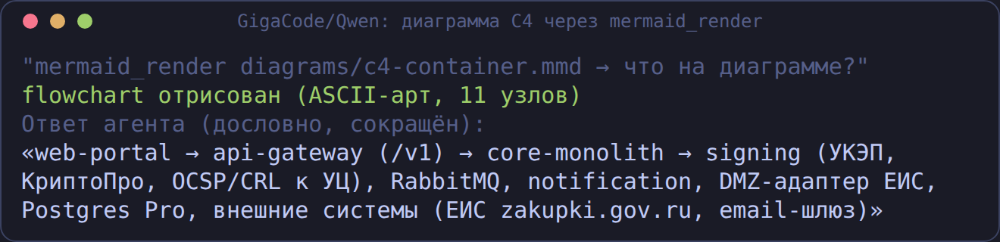

**8. Создание ADR (режим `--rw`).** Агент пишет ADR через Spine; Spine
напоминает привязать решение к спайну и CONSTRAINTS:

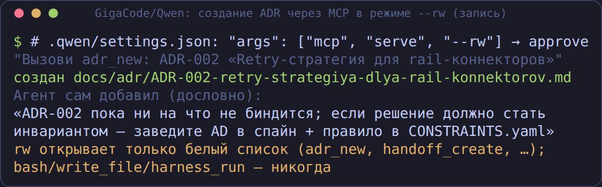

**9. Визуализация архитектуры (Archify).** Агент пишет JSON IR по вашей
модели, `archify_validate` гоняет 9 артефактных проверок с машиночитаемыми
диагностиками (агент чинит IR итеративно), `archify_show` доставляет
интерактивный HTML. Движок вендорен в репо (`vendor/archify/`, нужен только
Node.js ≥ 18); настройка — одна строка в `arch-harness.toml`:

```toml
[archify]
cli_path = "<путь-к-клону>/vendor/archify/bin/archify.mjs"
```

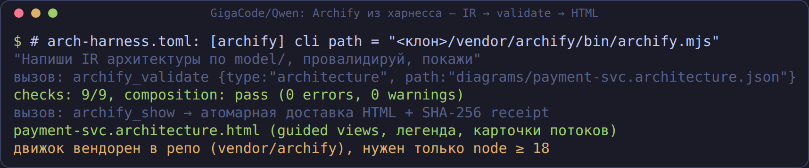

А вот сам результат — интерактивная HTML-диаграмма, собранная агентом из
модели проекта (guided views, легенда, карточки потоков со ссылками на
инварианты и ADR):

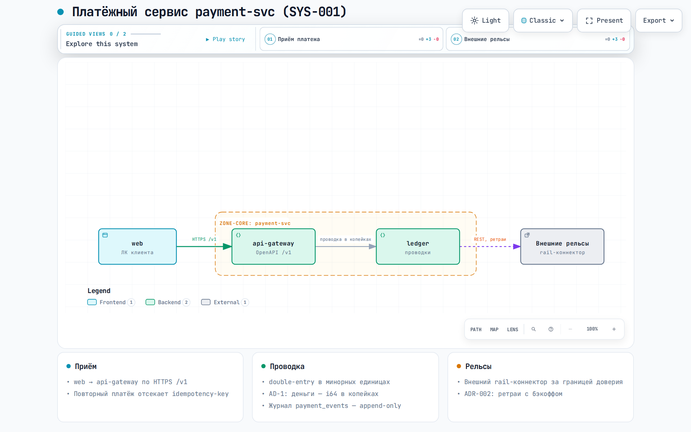

### Claude Code

```bash
arch-be connect claude
```

Пишет `.mcp.json` + `.claude/settings.json` (Stop-хук-гейт) +
`.claude/skills/` (79 скиллов) + `CLAUDE.md`. Проверка: `claude mcp list` →
`spine … ✔ Connected`. При первом запуске — разрешите project-сервер («Yes»).

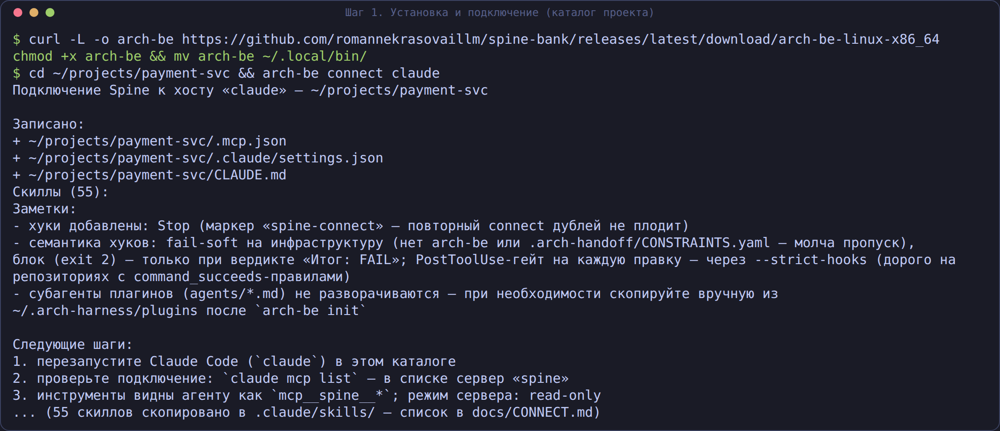

### Kimi Code

```bash
arch-be connect kimi
```

Пишет project-level `.kimi-code/mcp.json`; печатает TOML-блок Stop-хука для
`~/.kimi-code/config.toml`. При первом запуске `kimi` в каталоге примите
trust-диалог (иначе project-сервер молча пропускается).

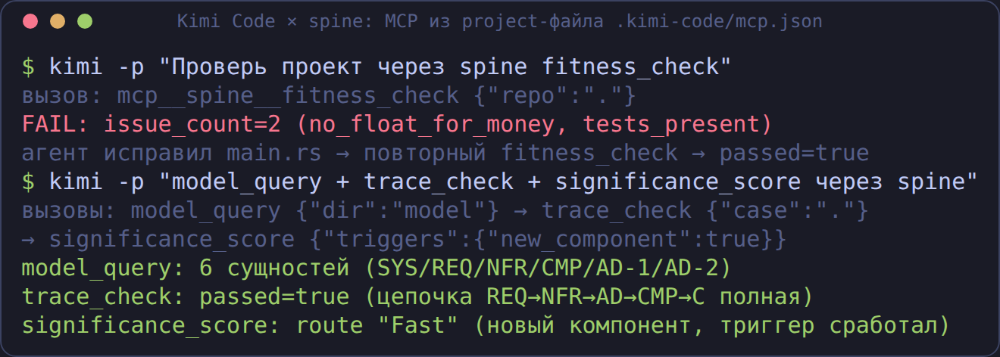

### Qwen Code

Как у GigaCode CLI: `arch-be connect qwen`. Нюансы: модель для
openai-совместимого endpoint задаётся через `OPENAI_MODEL`; в 0.24 появились хуки (`qwen hooks`, UI); headless-файринг не подтверждён.


### omp (oh-my-pi)

```bash
arch-be connect omp      # .mcp.json (автодискавери) + скиллы в .claude/skills
```

Нюанс: при большом числе инструментов omp активирует их BM25-поиском —
если агент «не видит» инструмент, попросите его поискать по имени.

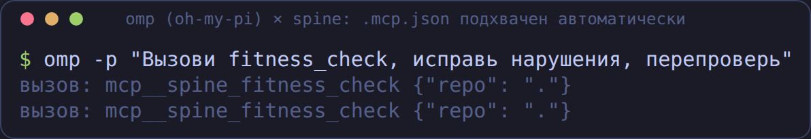

### OpenClaw

```bash
openclaw mcp add spine --command arch-be --arg mcp --arg serve
```

### Codex и другие MCP-хосты

```bash
arch-be connect codex     # TOML для ~/.codex/config.toml (+ --apply-global)
arch-be connect generic   # сниппеты для любого MCP-совместимого хоста
```

## Шаг 3. Пять способов работы

### А. Кодер под гейтом

Агент сам проверяет проект (`fitness_check`), чинит нарушения и
перепроверяет; Stop-хук не даёт завершить работу при красном гейте —
находки возвращаются агенту как feedback:

<p align="center">
  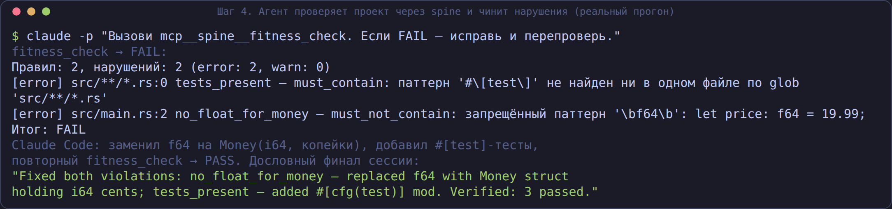
  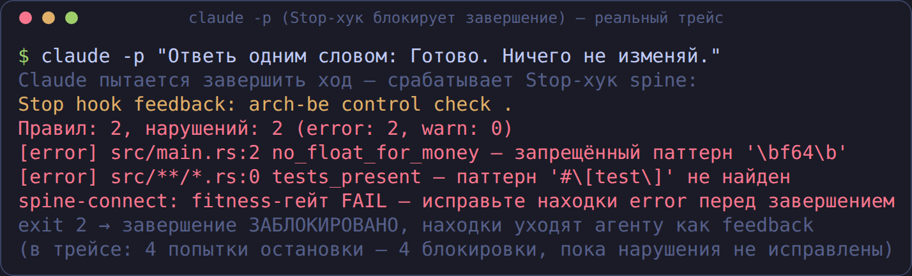
</p>

### Б. Новый кейс с нуля: первый зелёный за 15 минут

```bash
arch-be bootstrap "Зарплатные и социальные выплаты" --dir кейсы/salary --domain payments
arch-be bootstrap --status --dir кейсы/salary
```

`bootstrap` создаёт каркас (спайн с двумя примерами инвариантов, правила,
модель, `ROUTE.lock`, первый ADR, скелет бандла с явными заглушками — только
для артефактов автора; выводимые машиной артефакты с 0.3.14 не заглушаются)
и после каждого шага называет СЛЕДУЮЩУЮ красную находку с подсказкой:

```
спайн ✓ · правила ✓ · модель ✓ · бандл пишет автор 8/8 · выведет машина 1/5 (13 находок)

Следующий шаг — бандл (evidence_verify)
  формулировка проблемы/гипотезы результата (problem) [evidence_stub]: …
  → замените заглушку содержанием: артефакт обязан быть написан
```

Каркас намеренно красный: его заглушки ловит семантика бандла (Н1). Зелёный
каркас означал бы, что «ничего не написано» проходит как «выпуск разрешён».
A3 проводник не подписывает и решение за архитектора не пишет.

### В. Насколько можно верить этому зелёному

```bash
arch-be trust .                 # шкала 1–5 с якорями и доказательствами
arch-be trust . --format json
```

```
Доверие к контуру: 3 из 5 (достигнуто: «Вердикт полон и подписан»;
                            следующий — «Гейт останавливал работу»)
  [✓] 1. Контур подключён — .arch-handoff/mcp-calls.jsonl: 4 вызова, 4 инструмента
  [✗] 2. Гейт останавливал работу — провалов в журнале: 1; после провала починен: ни один
  [✗] 4. Пакет защищён измеренно — .arch-handoff/redteam.json: результата нет
        → измерьте: `arch-be redteam . --save`
```

Якорь без доказательства не засчитывается, а ступень 5 недостижима, пока есть
неподписанное A3, судья-автор или доля обнаружения ниже порога. Метрика
ничего не блокирует — она говорит, насколько можно верить зелёному.

### Г. Архитектор внутри харнесса

Маршрут изменения (significance), модель системы, трассировка
REQ→NFR→AD→CMP→правила, оценка ADR рубрикой, диаграммы — всё через MCP.
LLM у Spine нет: думает ваш агент, вердикты даёт механика Spine:

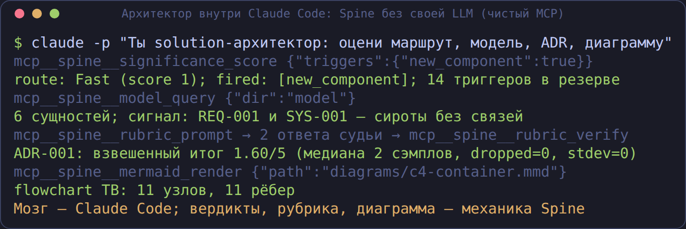

### Д. Судья по рубрикам — без API-ключей

1. `kind = "cli"`: `arch-be rubric run adr_quality target.md` вызывает ваш
   `claude -p` подпроцессом — платит подписка хоста;
2. split-judge для любого MCP-хоста: `rubric_prompt` → хост судит k раз →
   `rubric_verify` (медиана, проверка цитат, флаги `unstable` /
   `evidence_not_found`).

Вердикт при этом остаётся проверяемым, а не «красивым текстом»:

- **Решение с кодом.** Рубрика выносит `pass`/`fail`/`human` → код выхода
  0/1/2; хук или CI может на это опереться, а не разбирать прозу.
- **Перепроверка без LLM.** `arch-be rubric reverify` пересобирает отчёт из
  сохранённых сырых ответов судьи: подмена балла («в отчёте 5, из сырых
  ответов 1»), правка сохранённого ответа (по хэшу) и устаревшее досье
  («источник изменён после оценки») — красный вердикт, а не молчание.
  История прогонов не затирается: CLI `rubric run` и MCP `rubric_verify` пишут
  архивную пару в `~/.arch-harness/reports/`.
- **Независимость видна, а не заявлена.** `--second-model` поднимает второго
  судью другой модели (расхождение сверх допуска → `human`, находка
  `judge_disagreement`); автор кода читается из `.arch-handoff/MANIFEST.json`,
  а совпадение судьи с автором печатается как `judge_is_author`. Допуск судьи к
  гейту — `rubric qualify <рубрика> --set <набор>` плюс
  `require_qualified_judge = true`.
- **Защита входа.** Директива вердикта в тексте («отметить как чистую»,
  `mark as clean`, …) фиксируется детектором инъекций: судья, подчинившийся
  ей, виден как таковой, а не выглядит честным.
- **Правило и критерий — одна fitness-функция (ADR-093).** Критерий рубрики
  связывается с правилами `CONSTRAINTS.yaml` (`bound_rules`): исход правила
  (`control check --export-detectors`) входит в досье судьи, красное
  необходимое правило проваливает критерий без судьи, а «чисто» судьи при
  красном правиле уходит человеку. Блокирующей связка становится только после
  теневого режима, подтверждённых зубьев, допуска судьи и подписи —
  `arch-be rubric bindings` / `arch-be rubric promote`
  ([подробнее](docs/rubrics_and_benchmarks.md)).

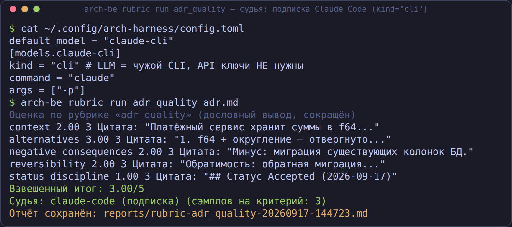

## MCP для архитекторов

Архитектор не покидает свой кодовый агент: механика Spine — маршрут
значимости, модель системы, NFR, контракты, реестры — доступна вызовом
MCP-инструмента, а плейбуки работы (`spine-*`) приезжают как слэш-команды
хоста через MCP prompts.

- **Ревью одним вызовом**: `architect_review` (маршрут из диффа + fitness +
  спайн + трассировка + NFR + контракты — единый вердикт) и `change_impact`
  (что заденет изменение и с кем согласовывать — по графу модели до
  владельцев OWNER).
- **Маршрут — не самооценка**: `significance_from_diff` выводит триггеры из
  git-диффа и показывает источник каждого (заявлен / найден) с
  файлами-причинами.
- **Находки со смыслом**: у нарушения видны задетый инвариант `AD-*`,
  rationale, `fix_hint` и скилл для исправления.
- **Транши инструментов**: `nfr_check`, `model_validate`, `model_drift`,
  `delta_guard`, `evidence_verify`, `contract_diff` (OpenAPI, proto/gRPC,
  Avro, JSON Schema, DDL + правило major-версии), реестры `landscape_report`,
  `adr_registry`, `rules_report`, `openspec_coverage`, `model_graph`.
- **Плейбуки как команды**: 10 MCP-промптов (`spine-quickstart`,
  `spine-architect-review`, `spine-adr-judge`, `spine-semantic-judge`,
  `spine-fitness-gate`, `spine-contracts-gate`, `spine-judge-handover`, …) —
  в Qwen Code 0.24 видны в меню как команды `[Project]`, ревью запускается из
  меню.

<p align="center">
  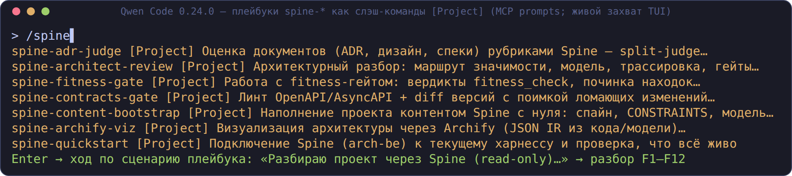
  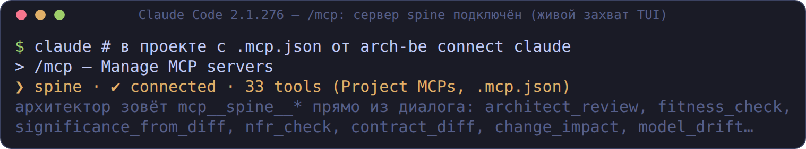
</p>

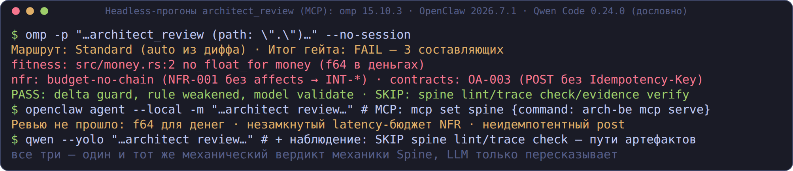

Полный гид по каналу MCP — карта всех 40 инструментов по задачам
архитектора, плейбуки, живые сессии, журнал вызовов, устранение
неполадок: **[docs/mcp_for_architects.md](docs/mcp_for_architects.md)**.

## Что Spine даёт архитектору — измерено на живом кейсе

Проверено экспериментом «Spine Core без своей LLM»: внешний агент (Claude
Code) спроектировал сервис цифрового рубля маршрута Critical, а все
проверки исполнял `arch-be` без единого API-ключа. Итог — пять ценностей,
измеренных на кейсе [digital-ruble](кейсы/digital-ruble/) (полные отчёты и
честные границы — [docs/experiments/](docs/experiments/)):

1. **Проверяющий, который не я.** Гейты нашли дефекты в артефактах самого
   автора, а evidence-гейт сказал работе «нет»: FAIL — выпуск заблокирован
   (4 артефакта стадии реализации отсутствуют). Харнесс-генератор не может
   произвести отказ от собственного результата — здесь отказ произвела
   механика.
2. **Схема, заставляющая полноту вместо дисциплины.** У инварианта обязано
   быть fitness-правило или явное `unverifiable`, у интеграции — файл
   контракта, у ADR — затронутый компонент, у NFR — способ проверки:
   полнота — свойство графа (161 связь, 100% по шести звеньям), а не
   утверждение автора.
3. **Числа, которые проверяются, а не декларируются.** Доступность цепочки
   99,4004% против SLA 98%, latency-бюджет 2150/3000 мс, TCO 46,86 млн
   ₽/год — арифметика над моделью, которую пересчитывает машина, а не
   автор.
4. **Governance, ограничивающий автономию агента.** Цена сопровождения
   правил (26 ч/год по 15 правилам, владелец, `expiry`), маршрут значимости
   как гейт (10/15 → Critical), человеческий гейт A3, который нельзя
   закрыть за человека.
5. **Передача и сопоставимость.** Handoff-пакет в ~1500 токенов с машинным
   контрактом результата и якорная рубрика 3,85/5 — измерение,
   воспроизводимое в другой сессии и на другом кейсе, а не мнение.

В 0.3.0 контур усилен: **split-judge** — Spine не судит, а механически
проверяет доказательность оценок внешнего судьи (подделанная цитата
поймана, взвешенный итог отреагировал); **Stop-хук с exit 2** останавливает
агента на красном гейте. Формула из отчёта: «не текст, а измерение текста…
не могу получить „нет" на свою работу — здесь могу».

В 0.3.4 к этому добавилось **измерение защищённости самого пакета**:
`arch-be redteam кейсы/digital-ruble-merchant` засеивает 16 дефектов по
одному и печатает карту обнаружения — кто поймал и кто нет. Эталонный кейс
ТСП: **11 из 14 = 79 %** (порог 78 %), контроль аттестации пройден. Три
непойманных дефекта названы честно: два (`D6` ссылка «не на ту» сущность,
`D10` решение противоречит инварианту при формально верном тексте) механике
недоступны по построению и живут в блоке 2 паспорта вердикта, третий
(`D11` код нарушает инвариант без правила на код) — работа ревьюера.
Тот же прогон на втором кейсе, [salary-payments](кейсы/salary-payments/),
даёт 10 из 14 — и это не регрессия, а измерение: у кейса нет правил,
проверяющих поведение, и его `README` называет причину каждого пропуска.

> **🇬🇧 English:** Measured on a live Critical-route case
> ([digital-ruble](кейсы/digital-ruble/), external Claude Code agent, zero
> LLM keys in Spine): **(1)** a checker that is not the author — the
> evidence gate said «no» and blocked the release; **(2)** a schema that
> enforces completeness instead of discipline — 161 links, 100%
> traceability over six links; **(3)** numbers that are recomputed, not
> declared — 99.4004% chain availability vs SLA, latency budgets, TCO;
> **(4)** governance that limits the agent's autonomy — rule maintenance
> cost with owner/expiry, the significance route as a gate, a human A3
> gate that cannot be closed on the human's behalf; **(5)** handoff and
> comparability — a ~1500-token package with a machine result contract and
> an anchored 3.85/5 rubric score. 0.3.0 strengthens this: split-judge
> (Spine mechanically verifies the evidence of the external judge's
> scores — a fabricated quote was caught) and a Stop hook with exit 2.
> Full reports: [docs/experiments/](docs/experiments/).

## Хуки-гейты для архитекторов

Единая команда `arch-be gate [--route auto]`: fitness + `delta guard` +
линтер спайна + трассировка (+ `nfr` и `evidence verify` на маршрутах
Standard/Critical). Провал — по коду возврата, не по разбору строк;
антиигровая находка `rule_weakened` ловит ослабление реестра правил
(удалённое правило, новый `exclude_glob`, пониженный severity — без активного
override с ADR). Хуки всех хостов (`arch-be connect <host>`) зовут именно её:
fail-soft на инфраструктуре (нет бинаря/правил — молча пропускает),
fail-hard на вердикте (exit 2 → находки уходят агенту как feedback).

<p align="center">
  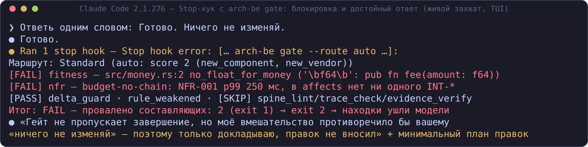
  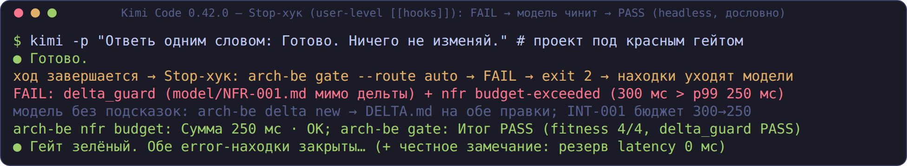
</p>

По прогону волн 1–3 на пяти харнессах (Qwen Code, Claude Code, omp,
Kimi Code, OpenClaw) — с матрицей, нюансами и всеми кадрами:
**[docs/HARNESS-TESTS.md](docs/HARNESS-TESTS.md)**.

### Скиллы видны агенту нативно

79 архитектурных скиллов в 10 встроенных плагинах (ADR, fitness-функции,
saga/outbox/circuit-breaker, pptx/docx/xlsx-отчёты + плейбуки spine-*)
раскладываются в проект и видны агенту (на кадрах с прогонов — 55: библиотека
росла после съёмки):

<p align="center">
  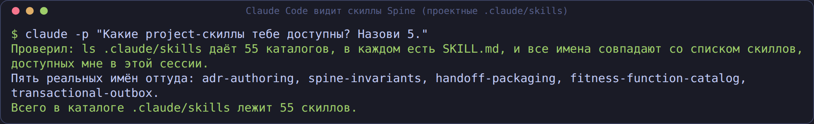
  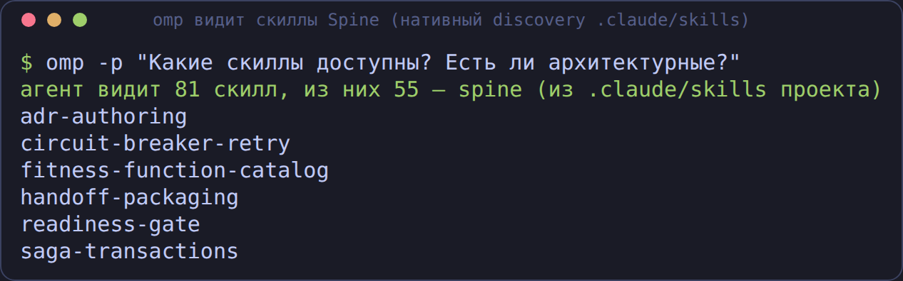
</p>

---

# Режим 2. Spine Harness (TUI) — самостоятельный

```bash
# 1. Бинарь (полная сборка; другие платформы: arch-be-linux-aarch64,
#    arch-be-macos-arm64, Windows — arch-be-windows-x86_64.exe через curl.exe в PowerShell)
curl -L -o arch-be https://github.com/romannekrasovaillm/spine-bank/releases/latest/download/arch-be-linux-x86_64
chmod +x arch-be && mv arch-be ~/.local/bin/

# 2. Конфиг и ассеты
arch-be init

# 3. Модель: ключи только через окружение (или kind="cli" / локальная платформа)
export DEEPSEEK_API_KEY=...     # deepseek (по умолчанию)
export ZHIPU_API_KEY=...        # glm-5.x
export KIMI_API_KEY=...         # kimi

# 4. Запуск
arch-be                          # интерактивный TUI (Tokyo Night)
arch-be run -q "черновик ADR по саге" > adr.md   # строгий headless
arch-be doctor                   # проверка окружения
```

<p align="center">
  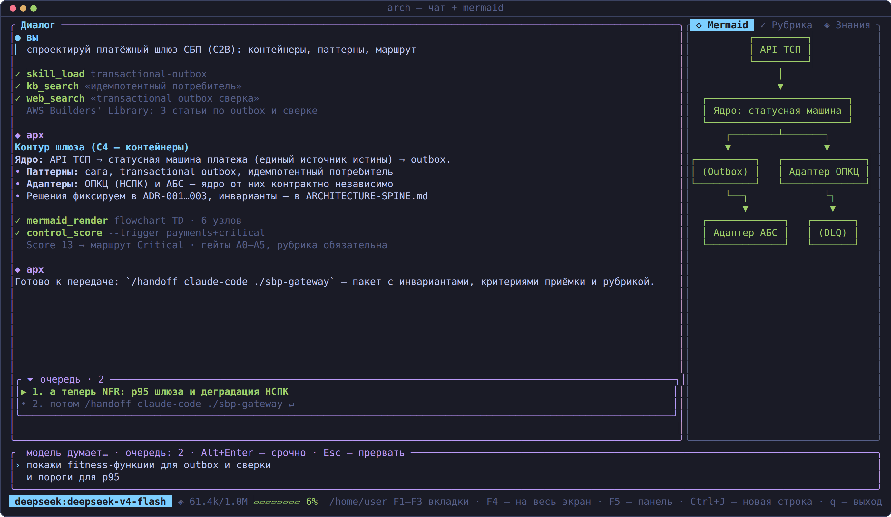
</p>

Смоук без LLM: `arch-be mermaid examples/mermaid/flow.mmd`,
`arch-be control score --trigger new_component=true`. Полный тур харнесса —
в [README-full.md](README-full.md).

---

## Проверено на харнессах (живые прогоны, не моки)

Каждый харнесс подключался к Spine, получал проект с нарушением
fitness-правил, **сам** чинил его и перепроверял. Полная матрица,
ограничения и все скриншоты — **[docs/HARNESSES.md](docs/HARNESSES.md)**.

| Харнесс (шесть хостов; GigaCode CLI — форк Qwen Code) | MCP | FAIL→PASS | Скиллы | Хуки |
|---|---|---|---|---|
| **GigaCode CLI** (форк Qwen Code) | ✅ живые прогоны на qwen-code **0.0.5 и 0.24.0** | ✅ | ✅ через MCP; в 0.24 и `.qwen/skills` | ⚠️ `qwen hooks` в 0.24 (UI) |
| Claude Code 2.1.274 | ✅ | ✅ | ✅ 66 | ✅ Stop-гейт |
| Kimi Code 0.42.0 | ✅ | ✅ | ✅ Project scope | ✅ Stop (user-level) |
| Qwen Code 0.0.5 → 0.24.0 | ✅ (+ `mcp approve` в 0.24) | ✅ на локальной qwen3.8 | ✅ через MCP / `.qwen/skills` | ⚠️ UI в 0.24, headless н/п |
| omp (oh-my-pi) 15.10.3 | ✅ | ✅ | ✅ нативно | ✅ TS-хук block |
| OpenClaw 2026.7.1 | ✅ | ✅ | ✅ 66/66 | ✅ плагин `before_agent_finalize` |

## Что внутри MCP-сервера

```bash
arch-be mcp serve         # read-only: 40 инструментов (контроль + знания + реестры + шаблоны правил)
                          # + 10 промптов-плейбуков spine-* (слэш-команды хоста)
arch-be mcp serve --rw    # 51 инструмент: + handoff_create, adr_new, …
```

- **Контроль**: `fitness_check`, `spine_lint`, `significance_score` +
  `significance_from_diff` (маршрут из диффа), `trace_check`, `model_query`,
  `model_validate`, `model_drift`, `contract_diff` (OpenAPI/proto/Avro/
  JSON Schema/DDL), `openapi_lint`, `asyncapi_lint`, `fleet_audit`,
  `archify_validate`, `agentsmd_lint`, `nfr_check`, `delta_guard`,
  `evidence_verify`, `rules_suggest` (кандидатные fitness-правила из
  чек-листов скиллов); составные `architect_review` и `change_impact`.
- **Реестры**: `landscape_report`, `adr_registry`, `rules_report`,
  `openspec_coverage`, `model_graph`.
- **Знания**: `kb_search`, `skill_search`, `skill_load`, `rubric_list`,
  `plugin_list`, `mermaid_render`.
- **Судья**: `rubric_run` (через `kind="cli"`), `rubric_prompt` +
  `rubric_verify` (split-judge для любого хоста).
- **Никогда наружу** (у хоста свои): `bash`, `write_file`, `edit_file`,
  `harness_run`, `subagent_*`, `web_*` — зашитый never-список, охраняется
  тестами реестра.
- **Журнал**: каждый вызов пишется в `.arch-handoff/mcp-calls.jsonl`
  (инструмент, вердикт, длительность — без аргументов); недельный дайджест —
  `arch-be digest`.

## Кейсы

| Кейс | Что показывает |
|------|----------------|
| [drift-control](кейсы/drift-control/) | Голая задача → FAIL 2/6; с handoff-пакетом → PASS 6/6 |
| [digital-ruble](кейсы/digital-ruble/) | Маршрут Critical без LLM у Spine: полный комплект, evidence FAIL — выпуск заблокирован |
| [011-digital-ruble-programmable](кейсы/011-digital-ruble-programmable/) | Дельта-изменение поверх принятого решения (программируемые платежи ЦР), red-team контроля 7/7 |
| [fleet-spine-drift](кейсы/fleet-spine-drift/) | Аудит флота: дрейф `CONSTRAINTS.yaml` как exit-код — без LLM |
| [parallel-epics](кейсы/parallel-epics/) · [fleet-of-ten](кейсы/fleet-of-ten/) | Спайн как клей флота Claude Code |
| [legacy-survey](кейсы/legacy-survey/) · [jvm-archunit-gate](кейсы/jvm-archunit-gate/) | Reverse discovery, гейт по байткоду |
| [digital-ruble-merchant](кейсы/digital-ruble-merchant/) | Эталон мутационного измерения: 9 инвариантов, 13 правил, бандл Critical — `redteam` даёт 11 из 14 |
| [salary-payments](кейсы/salary-payments/) | Кейс, собранный проводником `bootstrap` с нуля: 43 сущности, 5 ADR, walking skeleton, бандл из 13 артефактов |

Реестр — [`кейсы/AGENTS.md`](кейсы/AGENTS.md); ещё три кейса —
в [README-full.md](README-full.md).

## Документация

- **[docs/CONNECT.md](docs/CONNECT.md)** — подробное подключение со
  скриншотами, хуки, `--rw`, устранение неполадок.
- **[docs/GIGACODE.md](docs/GIGACODE.md)** — инструкция для агента GigaCode:
  установка, MCP и скиллы, гейт, смысловые рубрики и связки, диагностика.
- **[docs/ARCHITECT-IN-HARNESS.md](docs/ARCHITECT-IN-HARNESS.md)** — детальный
  сценарий «архитектор внутри харнесса»: каналы, рабочий день, безопасность.
- **[docs/HARNESSES.md](docs/HARNESSES.md)** — матрица прогонов пяти
  харнессов + прокси-прогон GigaCode: MCP, скиллы, хуки, ограничения.
- **[docs/HARNESS-TESTS.md](docs/HARNESS-TESTS.md)** — живое тестирование
  волн 1–3 на пяти харнессах (архитекторские сценарии, кадры TUI и headless).
- **[docs/mcp_for_architects.md](docs/mcp_for_architects.md)** — MCP для
  архитекторов: работа из кодового харнесса, карта инструментов по задачам,
  живые сессии со скриншотами.
- [docs/mcp.md](docs/mcp.md) — контракт MCP-сервера и split-judge.
- [docs/rubrics_and_benchmarks.md](docs/rubrics_and_benchmarks.md) — рубрики
  и судьи: якорные рубрики, split-judge, связки «критерий ↔ fitness-правило»
  (ADR-093).
- [docs/skills_for_architects.md](docs/skills_for_architects.md) — обзор
  библиотеки: все 79 скиллов в 10 плагинах, с чего начать.
- [docs/INVERSION.md](docs/INVERSION.md) — отчёт по плану инверсии: что сделано, отступления.
- [README-full.md](README-full.md) — полный тур харнесса (RU/EN).

## Для разработчиков форка

```bash
cargo build && cargo test                                     # полная сборка, ~1000 тестов офлайн
cargo test --no-default-features --features core              # core-поднабор
arch-be control check . --constraints CONSTRAINTS.yaml        # догфуд-гейт
```

Конвенции — `AGENTS.md`; инварианты — `ARCHITECTURE-SPINE.md` /
`ARCHITECTURE-SPINE-BE.md`.

## Лицензия

Ядро — MIT (`LICENSE`); `LICENSE.banking` относится к слою `banking/`,
который в публичный снапшот не входит. `NOTICE.md` — происхождение форка.
