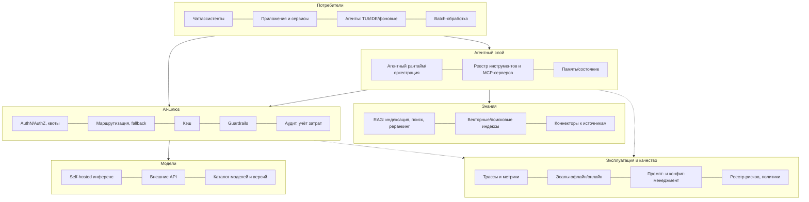

# Референсная архитектура AI-платформы

Связанные скиллы набора: `ai-gateway-finops` (шлюз, маршрутизация, квоты,
учёт затрат), `llm-tco` (экономика). Смежные наборы: LLM serving (инференс),
безопасность агентов, оценка и наблюдаемость агентов. Для оформления —
корпоративные скиллы отчётов и диаграмм, если установлены.

## Слои (каркас для любого ответа)

Описание каждого компонента, его ответственности, вариантов реализации
(open source и коммерческих) и критериев выбора — `references/components.md`.

## Как вести архитектурную работу

1. **Сценарии и потребители**: какие классы задач (чат, RAG, агенты,
   batch), объёмы, критичность, чувствительность данных. Без этого
   архитектура абстрактна.
2. **Ограничения**: размещение данных и регуляторика (персональные данные,
   отраслевые требования, коммерческая тайна), доступные модели (внешние API,
   отечественные модели, open-weight), железо, интеграционный ландшафт, ИБ.
3. **НФТ**: латентность, доступность, пропускная способность, изоляция
   арендаторов, аудит, стоимость — чек-лист `references/nfr-checklist.md`.
4. **Целевая архитектура** по слоям + ключевые решения (ADR-кандидаты:
   единый шлюз, self-hosted vs API, векторное хранилище, агентный фреймворк,
   протокол инструментов MCP, платформа наблюдаемости).
5. **Build vs buy** по компонентам (`references/components.md`).
6. **Дорожная карта** по модели зрелости (`references/patterns-maturity.md`).

## Принципы (из практики внедрений)

- **Единая точка входа к моделям** (шлюз) с самого начала: учёт, политики,
  смена провайдера без переписывания клиентов.
- **Модели взаимозаменяемы, данные и эвалы — нет**: инвестируй в датасеты,
  эвалы и наблюдаемость; модель меняется каждые 3–6 месяцев.
- **Инструменты агентов — это API с правами**: реестр, владельцы, минимальные
  привилегии, аудит; MCP как стандартный протокол подключения.
- **Безопасность по умолчанию**: недоверенный контент (веб, письма, документы)
  не должен управлять действиями с привилегиями (набор безопасности агентов).
- **Мульти-арендность**: квоты, изоляция данных и индексов, учёт затрат по
  командам с первого дня.

## Формат результата

Контекст и драйверы → слои с компонентами (диаграмма Mermaid/C4) → ключевые
решения с альтернативами → НФТ и как они обеспечиваются → риски → дорожная
карта. Конкретные продукты помечай как варианты, а не догму; версии и
зрелость продуктов меняются — проверяй.

## Связка со Spine

- Каждый слой референса — кандидат на CMP-карточку `model/`: шлюз, каталог моделей, инференс, RAG, агентный рантайм, guardrails, наблюдаемость. NFR платформы (доступность, латентность p99, стоимость) — числовые поля карточек; сверь бюджет цепочки `nfr budget`, доступность `nfr availability`, TCO `nfr cost`.
- Build vs buy по компонентам фиксируй ADR (минимум две альтернативы + статус-кво); необратимые выборы (вендор, формат данных) — триггер irreversible_migration → маршрут Critical.
- Модель зрелости — дорожная карта дельтами `changes/<id>/DELTA.md`: каждый шаг с критериями приёмки до реализации, откат — план в дельте.
